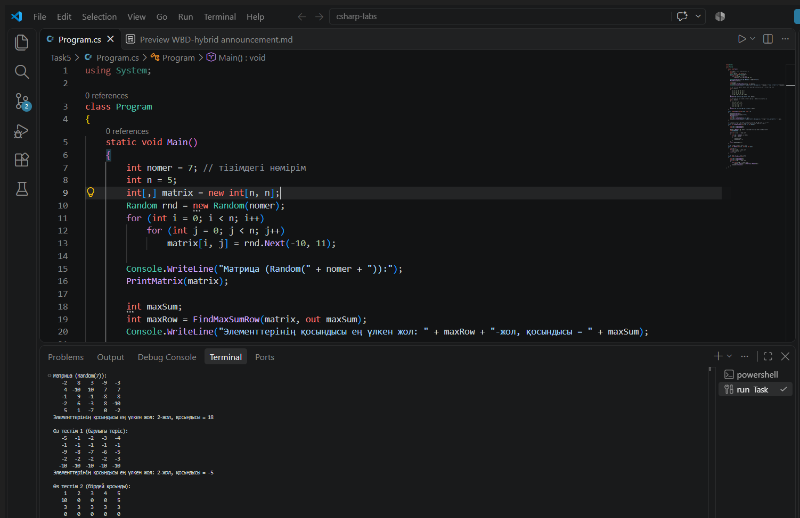

# 5-тапсырма: Екі өлшемді массивтер (нұсқа 4)


**Тапсырма:** элементтерінің қосындысы ең үлкен жолдың нөмірін (1-ден бастап) және сол қосындыны табу. Бірдей болса, бірінші жол көрсетіледі.

Есеп `FindMaxSumRow(int[,] m, out int maxSum)` методында, жол қосындысы `RowSum` методында, шығару `PrintMatrix(int[,] m)` методында жүреді.

| Тест | Кіріс | Қолмен есептеген жауап | Бағдарлама жауабы |
|---|---|---|---|
| Жеке тест | Random(7) | Жол қосындылары: -3, 18, 7, -1, -3 → 2-жол, 18 | 2-жол, қосындысы = 18 |
| Өз тестім 1 | Барлық элемент теріс | -15, -5, -35, -11, -50 → 2-жол, -5 | 2-жол, қосындысы = -5 |
| Өз тестім 2 | Төрт жолдың қосындысы 15 | 15, 15, 15, 0, 15 → 1-жол, 15 | 1-жол, қосындысы = 15 |

Random(7) матрицасы:
```
   -2    8    3   -9   -3
    4  -10   10    7    7
   -1    9   -1   -8    8
   -2    6   -3    8  -10
    5    1   -7    0   -2
```

## Сұрақтарға жауап
1) `matrix[i, j]` жазбасында `i` – жол нөмірі, `j` – баған нөмірі (екеуі де 0-ден басталады). `matrix.GetLength(0)` жолдар санын, `matrix.GetLength(1)` бағандар санын қайтарады, біздің жағдайда екеуі де 5.

2) Бастапқы мәнді 0 деп алсам, барлық жолдың қосындысы теріс болған жағдайда ешбір жол 0-ден үлкен болмайды да, бағдарлама «1-жол, 0» деген қате жауап береді. Сондықтан бастапқы мән ретінде бірінші жолдың нақты қосындысын аламын да, салыстыруды екінші жолдан бастаймын. Мұны «Өз тестім 1» тексереді.

3) Әр циклдағы ішкі цикл 5 рет, ал сыртқы цикл 5 рет орындалады, демек бір екі еселі цикл 5 × 5 = 25 рет. Толтыруда 25, `PrintMatrix`-те 25, `FindMaxSumRow` ішінде `RowSum` 5 рет шақырылып, әрқайсысы 5 рет айналады – тағы 25. Жеке тест үшін барлығы 75 рет.

## ЖИ қолдану
ЖИ (Claude) қолдандым: тапсырма шартын беріп, код құрылымы мен README жобасын сұрадым. Нәтижені өзім іске қосып, қосындыларды қолмен тексердім.
