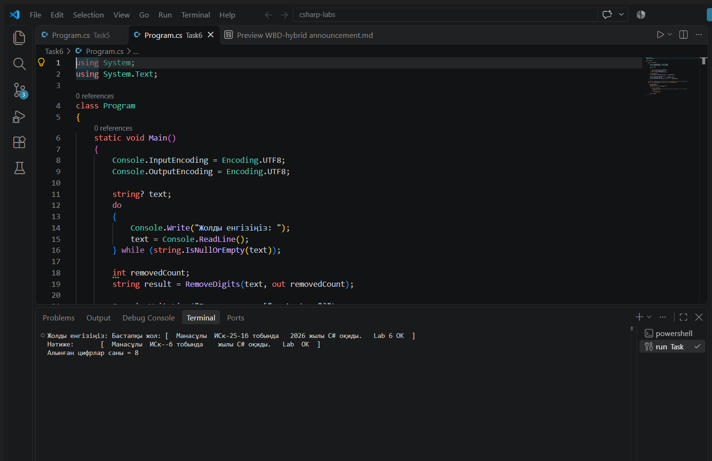

# 6-тапсырма: Символдар тіркесі (нұсқа 2)


**Тапсырма:** жолдағы цифрларды алып тастап, жаңа жолды және алынған цифрлар санын шығару.

Өңдеу `RemoveDigits(string text, out int removedCount)` методында жүреді: жаңа жол `result += ch;` арқылы символдарды бір-бірлеп қосып құрылады. Бос жол енгізілсе, `do-while` циклі қайта сұрайды.

| Тест | Кіріс | Қолмен есептеген жауап | Бағдарлама жауабы |
|---|---|---|---|
| Жеке тест | `  Манасұлы  ИСк-25-1б тобында   2026 жылы C# оқиды.   Lab 6 ОК  ` | 25, 1, 2026, 6 цифрлары → 8 цифр алынады, `  Манасұлы  ИСк--б тобында    жылы C# оқиды.   Lab  ОК  ` | Сол жол, алынған цифрлар саны = 8 |
| Өз тестім 1 | `Сәлем Әлем` (цифр жоқ) | Жол өзгермейді, 0 | `Сәлем Әлем`, 0 |
| Өз тестім 2 | `0123456789` (тек цифр) | Бос жол, 10 | `` (бос), 10 |

## Сұрақтарға жауап
1) `text[i]` жолдың i-ші орнындағы бір символды қайтарады, оның типі `char`. C#-та `string` өзгермейтін (immutable) тип, сондықтан индексатор тек оқуға арналған – `text[i] = 'a';` деп жазсақ, компилятор қате береді (CS0200).

2) Символды `'0'` мен `'9'` аралығында ма деп тексердім: `ch < '0' || ch > '9'` болса, ол цифр емес. `'5'` – бұл `char` типті символ, оның коды 53, ал `5` – `int` типті сан. Сондықтан `ch > 9` деп жазу қате: кез келген әріптің коды 9-дан үлкен, ол цифрларды да «цифр емес» деп санап кетеді.

3) Жоқ, ескі жол өзгермейді. `result += ch;` әр жолы ескі `result` пен `ch` қосылған жаңа жол объектісін жасап, `result` айнымалысын соған бағыттайды. Жол ұзын болса, мұндай жағдайда `StringBuilder` тиімдірек.

## Кездескен қате
Қате: алғашқы нұсқада шарт `if (ch < 0 || ch > 9)` болды. Компиляция қатесіз өтті, бірақ нәтиже бастапқы жолмен бірдей шықты – ешбір цифр алынбады (`ИСк-25-1б`, `2026` ішіндегі цифрлар орнында қалды).

Қалай түзеттім: `char` сан ретінде өзінің кодымен салыстырылатынын түсіндім (`'0'` = 48, `'9'` = 57). Шартты `ch < '0' || ch > '9'` деп символдармен салыстыруға ауыстырдым.

Түзеткен коммит: 79e306e

## Git
`git log --oneline --graph --all` командасының нәтижесі:
```
    c4fb2bc (HEAD -> main, origin/main, origin/HEAD) Merge pull request #2 from 784445555/task6-defense
|\  
| * 6e14763 (origin/task6-defense, task6-defense) Task6: output text changed to spaces count
| * 341ec96 Task6: remove spaces instead of digits (RemoveSpaces)
|/  
*   b0edeb0 Merge pull request #1 from 784445555/task5-defense
|\  
| * 0868cb8 (origin/task5-defense, task5-defense) Task 5: шығару жұмысы
|/  
* ba40aad Task5, Task6: VS Code-тағы нәтиже скриншоттары қосылды
* 377a920 README: топ атауы түзетілді (ИСк-25-1б), Task6 жеке тест нәтижесі жаңартылды
*   bb8e350 Merge branch 'task6'
|\  
| * d215cb1 (origin/task6, task6) Task6: README есебі (тесттер, кездескен қате, Git) және түбірдегі мазмұн
| * a2a1973 Task6: алынған цифрлар санын шығару
| * 79e306e Task6: цифрды тексеру түзетілді (ch > 9 емес:
*   c4fb2bc (HEAD -> main, origin/main, origin/HEAD) Merge pull request #2 from 784445555/task6-defense
|\  
| * 6e14763 (origin/task6-defense, task6-defense) Task6: output text changed to spaces count
| * 341ec96 Task6: remove spaces instead of digits (RemoveSpaces)
|/  
*   b0edeb0 Merge pull request #1 from 784445555/task5-defense
|\  
| * 0868cb8 (origin/task5-defense, task5-defense) Task 5: шығару жұмысы
|/  
* ba40aad Task5, Task6: VS Code-тағы нәтиже скриншоттары қосылды
* 377a920 README: топ атауы түзетілді (ИСк-25-1б), Task6 жеке тест нәтижесі жаңартылды
*   bb8e350 Merge branch 'task6'
|\  
| * d215cb1 (origin/task6, task6) Task6: README есебі (тесттер, кездескен қате, Git) және түбірдегі мазмұн
| * a2a1973 Task6: алынған цифрлар санын шығару
| * 79e306e Task6: цифрды тексеру түзетілді (ch > 9 емес, ch > '9' символымен салыстыру)
| * 26b66f5 Task6: жолды do-while арқылы енгізу және цифрларды алып тастау методы
|/  
*   910c219 Merge branch 'task5'
|\  
| * 9c88757 (origin/task5, task5) Task5: README есебі (тесттер, сұрақтарға жауап)
| * a1b17f2 Task5: өз тесттерім (барлығы теріс, бірдей қосынды)
| * 31bf785 Task5: ең үлкен қосындысы бар жолды табу методы (4-нұсқа)
| * 5b5e493 Task5: матрицаны толтыру және экранға шығару
:
*   c4fb2bc (HEAD -> main, origin/main, origin/HEAD) Merge pull request #2 from 784445555/task6-defense
|\  
| * 6e14763 (origin/task6-defense, task6-defense) Task6: output text changed to spaces count
| * 341ec96 Task6: remove spaces instead of digits (RemoveSpaces)
|/  
*   b0edeb0 Merge pull request #1 from 784445555/task5-defense
|\  
| * 0868cb8 (origin/task5-defense, task5-defense) Task 5: шығару жұмысы
|/  
* ba40aad Task5, Task6: VS Code-тағы нәтиже скриншоттары қосылды
* 377a920 README: топ атауы түзетілді (ИСк-25-1б), Task6 жеке тест нәтижесі жаңартылды
*   bb8e350 Merge branch 'task6'
|\  
| * d215cb1 (origin/task6, task6) Task6: README есебі (тесттер, кездескен қате, Git) және түбірдегі мазмұн
| * a2a1973 Task6: алынған цифрлар санын шығару
| * 79e306e Task6: цифрды тексеру түзетілді (ch > 9 емес:
*   c4fb2bc (HEAD -> main, origin/main, origin/HEAD) Merge pull request #2 from 784445555/task6-defense
|\  
| * 6e14763 (origin/task6-defense, task6-defense) Task6: output text changed to spaces count
| * 341ec96 Task6: remove spaces instead of digits (RemoveSpaces)
|/  
*   b0edeb0 Merge pull request #1 from 784445555/task5-defense
|\  
| * 0868cb8 (origin/task5-defense, task5-defense) Task 5: шығару жұмысы
|/  
* ba40aad Task5, Task6: VS Code-тағы нәтиже скриншоттары қосылды
* 377a920 README: топ атауы түзетілді (ИСк-25-1б), Task6 жеке тест нәтижесі жаңартылды
*   bb8e350 Merge branch 'task6'
|\  
| * d215cb1 (origin/task6, task6) Task6: README есебі (тесттер, кездескен қате, Git) және түбірдегі мазмұн
| * a2a1973 Task6: алынған цифрлар санын шығару
| * 79e306e Task6: цифрды тексеру түзетілді (ch > 9 емес, ch > '9' символымен салыстыру)
| * 26b66f5 Task6: жолды do-while арқылы енгізу және цифрларды алып тастау методы
|/  
*   910c219 Merge branch 'task5'
|\  
| * 9c88757 (origin/task5, task5) Task5: README есебі (тесттер, сұрақтарға жауап)
| * a1b17f2 Task5: өз тесттерім (барлығы теріс, бірдей қосынды)
| * 31bf785 Task5: ең үлкен қосындысы бар жолды табу методы (4-нұсқа)
| * 5b5e493 Task5: матрицаны толтыру және экранға шығару
:
*   c4fb2bc (HEAD -> main, origin/main, origin/HEAD) Merge pull request #2 from 784445555/task6-defense
|\  
| * 6e14763 (origin/task6-defense, task6-defense) Task6: output text changed to spaces count
| * 341ec96 Task6: remove spaces instead of digits (RemoveSpaces)
|/  
*   b0edeb0 Merge pull request #1 from 784445555/task5-defense
|\  
| * 0868cb8 (origin/task5-defense, task5-defense) Task 5: шығару жұмысы
|/  
* ba40aad Task5, Task6: VS Code-тағы нәтиже скриншоттары қосылды
* 377a920 README: топ атауы түзетілді (ИСк-25-1б), Task6 жеке тест нәтижесі жаңартылды
*   bb8e350 Merge branch 'task6'
|\  
| * d215cb1 (origin/task6, task6) Task6: README есебі (тесттер, кездескен қате, Git) және түбірдегі мазмұн
| * a2a1973 Task6: алынған цифрлар санын шығару
| * 79e306e Task6: цифрды тексеру түзетілді (ch > 9 емес, ch > '9' символымен салыстыру)
| * 26b66f5 Task6: жолды do-while арқылы енгізу және цифрларды алып тастау методы
|/  
*   910c219 Merge branch 'task5'
|\  
| * 9c88757 (origin/task5, task5) Task5: README есебі (тесттер, сұрақтарға жауап)
| * a1b17f2 Task5: өз тесттерім (барлығы теріс, бірдей қосынды)
| * 31bf785 Task5: ең үлкен қосындысы бар жолды табу методы (4-нұсқа)
| * 5b5e493 Task5: матрицаны толтыру және экранға шығару
:
```

1. task5 тармағында жасаған коммиттерім main-ге `git merge --no-ff task5` арқылы түсті: main-де біріктіру коммиті пайда болды, ал task5-тің барлық коммиттері main тарихына кірді. Біріктіруден кейін task5 тармағы жойылмады, ол сол соңғы коммитте тұр және GitHub-та Branches бөлімінде көрінеді.
2. `commit` өзгерістерді тек менің компьютерімдегі жергілікті репозиторийге сақтайды, ал `push` сол коммиттерді GitHub-қа жібереді. Push жасамасам, мұғалім GitHub-та ескі күйді көреді немесе жаңа коммиттерді мүлде көрмейді.
3. `.gitignore` файлын `dotnet new gitignore` арқылы жасадым, онда `[Bb]in/`, `[Oo]bj/`, `.vs/` сияқты жолдар бар. bin/ мен obj/ – құрастыру кезінде автоматты пайда болатын файлдар (dll, exe, уақытша файлдар), оларды `dotnet build` кез келген уақытта қайта жасайды, сондықтан репозиторийге қосу артық әрі көлемді.

## ЖИ қолдану
ЖИ (Claude) қолдандым: тапсырма шартын беріп, код пен README жобасын сұрадым. Цифрды тексерудегі қатені іске қосу нәтижесінен байқап, түзеттім.
## Қорғау видеосы
https://t.me/tecrgr
